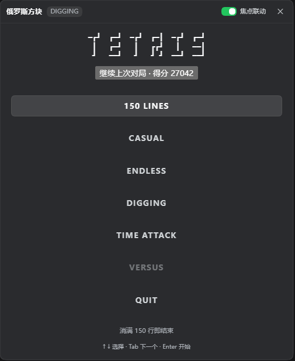
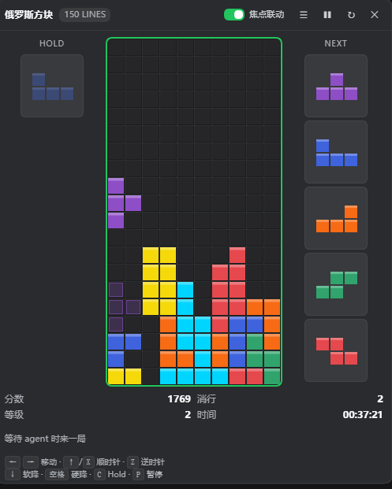

<div align="center">

# dsh-plugin-tetris

**趁 agent 干活的时候，在 DSH Web GUI 里来一局俄罗斯方块。**

[中文](README.md) | [English](README.en.md)

[](https://github.com/topics/dsh-plugin)

| 模式菜单 | 对局 |
|:---:|:---:|
|  |  |

</div>

## 背景

用 DSH 写代码的时候，等 agent 跑任务总有几十秒空档，于是把它做成了一个插件：
游戏面板挂在 DSH 的框架级浮动层上，agent 开始工作时自动出现；右下角常驻一个圆形
T 形方块图标，随时点开就能玩，面板会从图标的位置弹出。

引擎不是随手写的——它是我另一个项目
[**tetris-terminal**](https://github.com/zlh124/tetris-terminal)（Python 终端版俄罗斯方块）
的逐行 TypeScript 移植：7-bag、SRS 墙踢、Hold、Ghost、T-Spin、B2B、消行动画都和终端版一致，
连终端版的一些怪癖也一并保留了。规则和手感是它先做出来的。

> 觉得好玩的话，去给 [**tetris-terminal**](https://github.com/zlh124/tetris-terminal) 点个 ⭐ 吧。

## 操作

| 键 | 动作 |
|---|---|
| `←` `→` / `A` `D` | 左右移动 |
| `↑` / `W` / `X` | 顺时针旋转 |
| `Z` | 逆时针旋转 |
| `↓` / `S` | 软降 |
| `空格` | 硬降 |
| `C` | Hold |
| `P` | 暂停 / 继续 |

先点一下棋盘再用键盘；聚焦后棋盘会有一圈绿色描边。标题栏的「焦点联动」滑块控制
"失焦自动暂停 + 对话结束把焦点交还游戏"。

## 安装

```bash
dsh plugin --profile web add dsh-plugin-tetris
```

装完不需要刷新页面。卸载：

```bash
dsh plugin --profile web remove dsh-plugin-tetris
```

从源码开发：`npm install && npm run build`，然后
`dsh plugin --profile web add link:"$PWD"`。

> 仓库里提交了构建产物 `lib/`，所以也可以直接从 git 装：
> `dsh plugin --profile web add git+https://github.com/<you>/dsh-plugin-tetris.git`。

## License

MIT。引擎逻辑来自 [tetris-terminal](https://github.com/zlh124/tetris-terminal)（MIT, jayzhu）。
